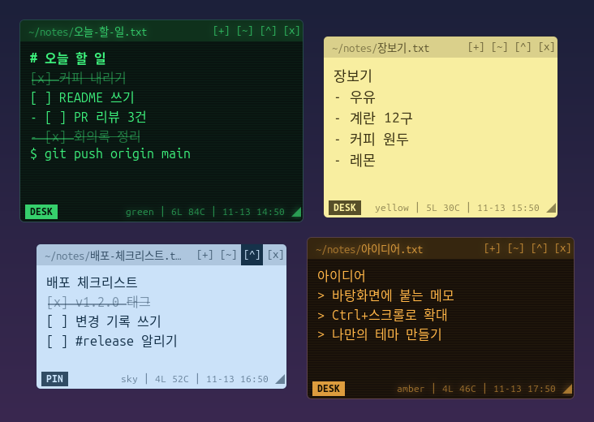

# sticky-notes

[English](README.md) | **한국어** | [简体中文](README.zh-CN.md)

**리눅스(GNOME, Wayland) 바탕화면에 붙여 두는 스티커 메모.** 메모는 모든 작업 공간에서 다른 창 아래 바탕화면에 깔려 있다가, 쓸 때는 앞으로 올라옵니다. 기본 테마는 터미널 느낌이고, 종이 포스트잇 테마와 직접 만든 테마로도 바꿀 수 있습니다.



## 특징

- **바탕화면에 붙어 있음**: 메모는 다른 창 아래에 깔리고 모든 작업 공간에 보입니다. 메모를 누르거나 개요 화면·Alt+Tab에서 고르면 그 메모가 앞으로 올라오고, 다른 곳을 누르면 다시 내려갑니다.
- **위치·크기 기억**: 다시 실행하거나 다시 로그인해도 그 자리에 그 크기로 돌아옵니다.
- **테마**: CRT 스캔라인과 글자 번짐이 있는 터미널 테마 6가지, 종이 포스트잇 테마 5가지, 그리고 [직접 만든 테마 파일](#나만의-테마-만들기).
- **터미널 느낌**: 고정폭 글꼴, 파일 이름 같은 제목줄, vim 스타일 상태줄.
- **체크리스트**: `[ ]`를 클릭하면 `[x]`가 되고, 끝난 줄에는 취소선이 그어집니다.
- **실행 취소/다시 실행**: 한 글자씩 되돌립니다. 붙여넣기와 체크박스 토글은 한 번에 되돌립니다.
- **메모마다 글자 크기 조절**: 8~32pt.
- **삭제 확인**: 내용이 있는 메모는 `rm -i`처럼 `[y/N]`으로 한 번 더 묻습니다.
- **PEEK**: 모든 메모를 잠깐 다른 창 위로 꺼내 볼 수 있습니다.
- **한국어·영어·중국어(간체) 화면**: 시스템 언어를 따라갑니다.

## 요구 사항

- Linux + GNOME Wayland 세션(XWayland 사용). Ubuntu 26.04 / GNOME 50에서 테스트했습니다.
- .deb와 snap은 필요한 것을 알아서 갖춥니다. 소스에서 실행하려면 Python 3, PyGObject, GTK 3가 필요한데, Ubuntu 데스크톱에는 기본으로 들어 있습니다.

```sh
sudo apt install python3-gi gir1.2-gtk-3.0
```

글꼴은 `Ubuntu Sans Mono`를 쓰고, 한글·한자는 시스템 언어에 맞는 `Noto Sans Mono CJK`(`fonts-noto-cjk`)로 표시합니다. 둘 다 없으면 시스템 고정폭 글꼴을 씁니다.

## 설치

### Ubuntu / Debian: .deb (추천)

[sticky-notes.deb](https://github.com/Kimsunmin/sticky-notes/releases/latest/download/sticky-notes.deb)를 내려받아 열거나, 다음을 실행합니다.

```sh
wget https://github.com/Kimsunmin/sticky-notes/releases/latest/download/sticky-notes.deb
sudo apt install ./sticky-notes.deb
```

로그인할 때 자동으로 실행하려면:

```sh
mkdir -p ~/.config/autostart
cp /usr/share/applications/io.github.kimsunmin.StickyNotes.desktop ~/.config/autostart/
```

### Snap Store

```sh
sudo snap install sticky-notes
```

snap은 메모와 테마를 자기 폴더 `~/snap/sticky-notes/current/` 안에 저장합니다([데이터](#데이터) 참고). 로그인할 때 자동으로 실행하려면:

```sh
mkdir -p ~/.config/autostart
cp /var/lib/snapd/desktop/applications/sticky-notes_sticky-notes.desktop ~/.config/autostart/
```

### 소스에서 설치

```sh
git clone https://github.com/Kimsunmin/sticky-notes.git
cd sticky-notes
./install.sh              # 앱 목록에 등록
./install.sh --autostart  # 로그인할 때 자동 실행도 켜기
```

`install.sh`는 `~/.local/share/applications`에 데스크톱 파일을, `~/.local/share/icons`에 아이콘을 넣습니다. 데스크톱 파일은 저장소 안의 `sticky_notes.py`를 실행하므로, 설치한 뒤에는 저장소 폴더를 옮기지 마세요. 옮겼다면 `./install.sh`를 다시 실행하면 됩니다.

## 업데이트

- **.deb**: 새 `sticky-notes.deb`를 내려받아 같은 방법으로 설치한 뒤, `sticky-notes --quit`으로 앱을 끄고 다시 실행합니다.
- **Snap**: 자동으로 업데이트됩니다. 앱이 실행 중이면 앱을 끈 뒤에 적용됩니다.
- **소스**:

```sh
cd sticky-notes
git pull
./install.sh
```

`install.sh`가 앱 등록 정보(자동 실행을 켰다면 그것도)를 새로 쓰고, 실행 중인 앱을 새 코드로 다시 띄웁니다.

어떤 방법이든 메모는 따로 저장되어 있어서 그대로 남습니다.

## 사용법

앱 목록에서 **스티커 메모**를 실행하거나 `sticky-notes`를 실행합니다(소스에서 설치했다면 `./sticky_notes.py`).

### 마우스

| 동작 | 방법 |
|---|---|
| 옮기기 | 제목줄을 끌기 |
| 크기 조절 | 오른쪽 아래 `◢`를 끌기 |
| 새 메모 / 테마 / 고정 / 삭제 | 제목줄의 `[+]` `[~]` `[^]` `[x]` |
| 체크박스 토글 | `[ ]` 또는 `[x]`를 클릭 |

### 단축키

| 키 | 동작 |
|---|---|
| Ctrl+N | 새 메모 |
| Ctrl+T | 다음 테마로 바꾸기 |
| Ctrl+P | 다른 창 위에 고정 / 해제 |
| Ctrl+W | 메모 삭제 (`y`로 확인, 다른 키는 취소) |
| Ctrl+Z | 실행 취소 |
| Ctrl+Shift+Z, Ctrl+Y | 다시 실행 |
| Ctrl+= / Ctrl+- / Ctrl+0 | 글자 크게 / 작게 / 기본(12pt) |
| Ctrl+마우스 휠 | 글자 크기 조절 |

### 상태줄 모드

| 모드 | 뜻 |
|---|---|
| `DESK` | 바탕화면에 깔려 있음 (다른 창 아래, 포커스를 받은 동안만 위) |
| `PIN` | 다른 창 위에 고정됨 |
| `PEEK` | 잠깐 앞으로 꺼내 보는 중 |

### 가려진 메모 꺼내 보기 (PEEK)

앱이 이미 실행 중일 때 다시 실행하면(앱 목록에서 아이콘 클릭 등) 모든 메모가 다른 창 위로 올라옵니다. 메모 밖을 클릭하거나 한 번 더 실행하면 다시 바탕화면으로 내려갑니다.

`--new` 옵션으로 실행하면 메모를 앞으로 꺼내면서 새 메모를 엽니다. 앱 아이콘을 우클릭해 **새 메모**를 골라도 됩니다. 이 명령을 GNOME 단축키로 등록해 두면 편합니다.

> 설정 → 키보드 → 키보드 바로 가기 → 사용자 지정 바로 가기
> 명령: `sticky-notes --new` (소스에서 설치했다면 `/저장소/경로/sticky_notes.py --new`)

### 메모 문법

```text
# 제목              굵게 표시
[ ] 할 일           클릭하면 [x]
- [x] 끝난 일       취소선
* [ ] 이것도 체크박스
```

제목줄의 `~/notes/첫-줄.txt`는 첫 줄로 만든 표시용 이름이고, 실제 파일은 아닙니다.

## 테마

| 종류 | 테마 |
|---|---|
| 터미널 (CRT 스캔라인과 글자 번짐) | `green`(기본), `amber`, `cyan`, `magenta`, `red`, `white` |
| 종이 | `yellow`, `pink`, `sky`, `mint`, `lilac` |

`[~]`를 누르면 색 견본이 붙은 목록에서 테마를 고를 수 있고, Ctrl+T를 누르면 다음 테마로 넘어갑니다. 테마는 메모마다 따로 정해집니다.

### 나만의 테마 만들기

`~/.config/sticky-notes/themes/` 폴더(snap은 `~/snap/sticky-notes/current/.config/sticky-notes/themes/`)에 `이름.theme` 파일을 넣으면 테마가 하나 생깁니다. `[~]` 메뉴 맨 아래의 **테마 폴더 열기**로 이 폴더를 열 수 있습니다.

```ini
# ~/.config/sticky-notes/themes/ocean.theme
[Theme]
Foreground=#e0f7ff
Background=#0b2a4a
Crt=true
```

| 키 | 뜻 |
|---|---|
| `Foreground` | 글자색. `#rrggbb`, `rgb(…)`, `navy` 같은 CSS 색을 쓸 수 있습니다. |
| `Background` | 배경색 |
| `Crt` | `true`면 터미널 테마처럼 스캔라인과 글자 번짐 효과를 넣고 배경을 조금 더 투명하게 합니다. 생략하면 `false`. |

- 파일 이름(확장자 제외)이 테마 이름이 됩니다. 영문, 숫자, `-`, `_`만 쓸 수 있습니다.
- 기본 테마와 이름이 같으면 기본 테마를 덮어씁니다.
- 파일을 고친 뒤 `[~]` 메뉴를 다시 열면 바로 반영됩니다.
- 읽을 수 없는 파일은 건너뛰고 이유를 stderr에 출력합니다. 그 테마를 쓰던 메모는 파일을 고칠 때까지 `green`으로 보이고, 메모의 테마 설정은 지워지지 않습니다.

## 자주 묻는 질문

### GNOME Wayland에서 스티커 메모를 바탕화면에 붙여 둘 수 있나요?

GNOME Wayland에서는 앱이 자기 창을 다른 창 아래에 둘 수 없습니다. sticky-notes는 XWayland로 실행하면서 표준 X11 창 힌트를 써서, 메모를 모든 작업 공간의 바탕화면에 다른 창 아래로 깔아 둡니다. 설치하고 실행하면 되고, 따로 설정할 것은 없습니다.

### 메모가 Alt+Tab과 독에 왜 나오나요?

GNOME에서는 창을 독, Alt+Tab, 개요 화면에서 숨기는 힌트가 하나로 묶여 있습니다. 개요 화면에서 메모를 찾을 수 있도록 숨기지 않았기 때문에 Alt+Tab과 독에도 나옵니다. 어디서 고르든 고른 메모가 앞으로 올라옵니다.

### 메모가 다른 창에 가려졌어요. 어떻게 보나요?

개요 화면이나 Alt+Tab에서 고르거나, 앱을 한 번 더 실행해서 모든 메모를 꺼내 보세요([PEEK](#가려진-메모-꺼내-보기-peek)). 늘 위에 두고 싶은 메모는 Ctrl+P로 고정하면 됩니다.

### 메모는 어디에 저장되나요? 백업은 어떻게 하나요?

모든 메모는 `~/.local/share/sticky-notes/notes.json` 한 파일에 있습니다(snap은 `~/snap/sticky-notes/current/.local/share/sticky-notes/notes.json`). 이 파일을 복사해 두면 백업이 됩니다.

### KDE Plasma, Xfce, X11 세션에서도 되나요?

GNOME 50(Ubuntu 26.04, Wayland)에서만 만들고 테스트했습니다. 표준 EWMH 창 힌트를 쓰므로 다른 데스크톱에서도 동작할 수 있지만 확인하지는 않았습니다.

## 데이터

| | 메모 | 직접 만든 테마 |
|---|---|---|
| .deb, 소스 | `~/.local/share/sticky-notes/notes.json` | `~/.config/sticky-notes/themes/` |
| Snap | `~/snap/sticky-notes/current/.local/share/sticky-notes/notes.json` | `~/snap/sticky-notes/current/.config/sticky-notes/themes/` |

바뀐 내용은 0.5초 안에 저장됩니다. 메모 파일을 읽을 수 없으면 덮어쓰지 않고 `notes.broken-<시각>.json`으로 옮겨 둡니다.

## 동작 방식

GNOME Wayland에서는 앱이 자기 창의 위치를 정하거나 "항상 아래에 두기" 같은 상태를 요청할 수 없습니다. 그래서 GTK 3을 X11 백엔드로 띄워(XWayland) 다음 X11 창 힌트를 씁니다.

- `_NET_WM_STATE_BELOW` / `ABOVE`: 바탕화면 / 고정·포커스
- `_NET_WM_STATE_STICKY`: 모든 작업 공간
- Motif 힌트에서 최대화·최소화 제거: 화면 가장자리로 끌어도 타일링되지 않음

`_NET_WM_STATE_SKIP_TASKBAR`는 쓰지 않습니다. GNOME은 이 힌트가 붙은 창을 독과 Alt+Tab뿐 아니라 개요에서도 숨기기 때문입니다.

GTK의 창 장식(CSD)을 쓰면 mutter가 그림자 폭만큼 어긋나게 배치해서 실행할 때마다 위치가 밀립니다. 그래서 장식 없는 RGBA 창에 테두리와 둥근 모서리를 직접 그립니다.

## 알려진 제한

- 바탕화면 보기(Super+D)는 일반 창을 모두 숨기는 기능이라 메모도 함께 숨겨질 수 있습니다.
- XWayland 앱이라 분수 배율(125% 등)에서는 흐리게 보일 수 있습니다.
- 창 그림자가 없고, 크기는 `◢` 손잡이로만 조절할 수 있습니다.
- 실행 취소 기록은 메모리에만 있어서 앱을 다시 시작하면 사라집니다.
- 마지막 메모를 삭제하면 앱이 종료됩니다. 앱을 다시 실행하면 새 메모가 열립니다.

## 제거

- **.deb**: `sudo apt remove sticky-notes`. 자동 실행을 켰다면 `~/.config/autostart/io.github.kimsunmin.StickyNotes.desktop`도 지웁니다.
- **Snap**: `sudo snap remove sticky-notes`. 메모가 든 snap 폴더도 함께 지워지므로, 남기려면 먼저 `notes.json`을 복사해 두세요.
- **소스**:

```sh
./sticky_notes.py --quit   # 실행 중이면 종료
rm -f ~/.local/share/applications/io.github.kimsunmin.StickyNotes.desktop \
   ~/.local/share/icons/hicolor/scalable/apps/io.github.kimsunmin.StickyNotes.svg \
   ~/.config/autostart/io.github.kimsunmin.StickyNotes.desktop
```

메모와 테마까지 지우려면(.deb, 소스):

```sh
rm -r ~/.local/share/sticky-notes ~/.config/sticky-notes
```

## 구조

```text
sticky_notes.py   앱 전체 (단일 파일)
install.sh        소스 설치, 업데이트, --autostart 로 자동 실행
data/             데스크톱 파일 템플릿, 아이콘, AppStream 메타정보
docs/             스크린샷
packaging/        .deb 빌드 스크립트
snap/             snap 패키지
.github/          릴리스 워크플로
```

## 릴리스 방법

1. `data/io.github.kimsunmin.StickyNotes.metainfo.xml` 맨 위에 `<release version="x.y.z" date="…">` 항목을 추가하고 커밋합니다. 버전은 여기에만 적습니다.
2. 태그를 push합니다: `git tag vx.y.z && git push origin vx.y.z`

GitHub Actions가 `sticky-notes.deb`와 snap을 만들어 릴리스에 붙입니다. 저장소 시크릿 `SNAPCRAFT_STORE_CREDENTIALS`가 있으면 Snap Store에도 올립니다.

## 라이선스

[MIT](LICENSE)
