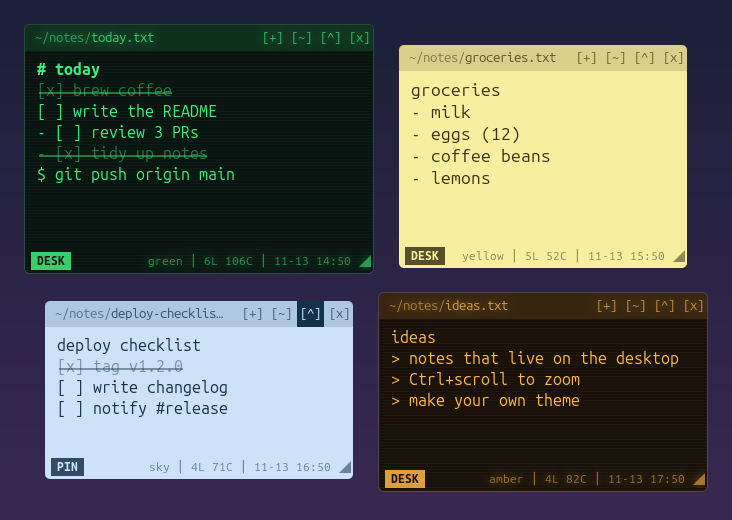

# sticky-notes

**English** | [한국어](README.ko.md) | [简体中文](README.zh-CN.md)

**Desktop sticky notes for Linux (GNOME, Wayland).** Notes stay on your wallpaper on every workspace, below your windows, and come to the front when you use them. The default theme looks like a terminal; paper sticky-note themes and themes you make yourself are one click away.



## Features

- **Lives on the desktop**: notes sit below other windows and show on every workspace. Click a note, or pick it in the Activities overview or Alt+Tab, and that note comes to the front. Click elsewhere and it goes back down.
- **Remembers position and size** across restarts and logins.
- **Themes**: six terminal themes with CRT scanlines and glow, five paper sticky-note themes, and [your own theme files](#make-your-own-theme).
- **Terminal feel**: monospace font, file-name title bar, vim-style status line.
- **Checklists**: click `[ ]` to make it `[x]`; done lines are struck through.
- **Undo and redo**, one character at a time.
- **Font size per note**: 8–32 pt.
- **Delete confirmation**: notes with text ask `[y/N]` first, like `rm -i`.
- **PEEK**: bring every note above your windows for a quick look.
- **English, Korean and Simplified Chinese** interface, following your system language.

## Requirements

- Linux with a GNOME Wayland session (runs through XWayland). Tested on Ubuntu 26.04 with GNOME 50.
- Python 3, PyGObject, GTK 3

```sh
sudo apt install python3-gi gir1.2-gtk-3.0
```

The font is `Ubuntu Sans Mono`. CJK text uses `Noto Sans Mono CJK` (`fonts-noto-cjk`) in the variant that matches your language. If neither is installed, the system monospace font is used.

## Install

```sh
git clone https://github.com/Kimsunmin/sticky-notes.git
cd sticky-notes
./install.sh              # add to the app grid
./install.sh --autostart  # also start on login
```

`install.sh` puts a desktop file in `~/.local/share/applications` and an icon in `~/.local/share/icons`. The desktop file runs `sticky_notes.py` from the cloned folder, so don't move the folder after installing. If you do, run `./install.sh` again.

## Update

```sh
cd sticky-notes
git pull
./install.sh
```

`install.sh` re-registers the app (and autostart, if it is on) and restarts the running app with the new code. Your notes are stored separately and are kept.

## Usage

Launch **Sticky Notes** from the app grid, or run `./sticky_notes.py`.

### Mouse

| Action | How |
|---|---|
| Move | Drag the title bar |
| Resize | Drag `◢` in the bottom-right corner |
| New note / theme / pin / delete | `[+]` `[~]` `[^]` `[x]` in the title bar |
| Toggle a checkbox | Click `[ ]` or `[x]` |

### Keyboard shortcuts

| Keys | Action |
|---|---|
| Ctrl+N | New note |
| Ctrl+T | Next theme |
| Ctrl+P | Keep above other windows (pin) / unpin |
| Ctrl+W | Delete note (`y` to confirm, any other key cancels) |
| Ctrl+Z | Undo |
| Ctrl+Shift+Z, Ctrl+Y | Redo |
| Ctrl+= / Ctrl+- / Ctrl+0 | Bigger / smaller / default (12 pt) font |
| Ctrl+mouse wheel | Change font size |

### Status line modes

| Mode | Meaning |
|---|---|
| `DESK` | On the desktop, below other windows (in front only while focused) |
| `PIN` | Kept above other windows |
| `PEEK` | Brought to the front for a quick look |

### Bring hidden notes to the front (PEEK)

Launch the app again while it is running (for example, click its icon in the app grid) and every note comes above your windows. Click outside the notes, or launch it once more, and they go back to the desktop.

`--new` brings the notes forward and opens a new note. You can also right-click the app icon and choose **New Note**. It's handy as a GNOME keyboard shortcut:

> Settings → Keyboard → Keyboard Shortcuts → Custom Shortcuts
> Command: `/path/to/sticky-notes/sticky_notes.py --new`

### Note syntax

```text
# Heading           bold
[ ] todo            click to make it [x]
- [x] done          struck through
* [ ] also a checkbox
```

The title bar shows `~/notes/first-line.txt`. It is a display name made from the first line, not a real file.

## Themes

| Kind | Themes |
|---|---|
| Terminal (CRT scanlines and glow) | `green` (default), `amber`, `cyan`, `magenta`, `red`, `white` |
| Paper | `yellow`, `pink`, `sky`, `mint`, `lilac` |

Click `[~]` to pick a theme from a list with color swatches, or press Ctrl+T to switch to the next one. Each note keeps its own theme.

### Make your own theme

Put a `name.theme` file in `~/.config/sticky-notes/themes/` and it shows up as a theme. **Open themes folder** at the bottom of the `[~]` menu opens this folder.

```ini
# ~/.config/sticky-notes/themes/ocean.theme
[Theme]
Foreground=#e0f7ff
Background=#0b2a4a
Crt=true
```

| Key | Meaning |
|---|---|
| `Foreground` | Text color. Any CSS color works: `#rrggbb`, `rgb(…)`, or a name like `navy`. |
| `Background` | Background color |
| `Crt` | `true` adds the terminal themes' scanlines and glow and makes the background a little more transparent. Defaults to `false`. |

- The file name (without `.theme`) is the theme name. Use only letters, digits, `-` and `_`.
- A theme with the same name as a built-in one replaces it.
- After editing a file, open the `[~]` menu again to apply it.
- Files that can't be read are skipped (the reason is printed to stderr). Notes using such a theme are shown in `green` until the file is fixed; their theme setting is not lost.

## FAQ

### How do I keep sticky notes on the desktop in GNOME on Wayland?

GNOME on Wayland doesn't let apps place their windows below other windows. sticky-notes runs through XWayland and uses standard X11 window hints, so its notes stay on the desktop below your windows, on every workspace. Install it and launch it; there is nothing to configure.

### Why do notes show up in Alt+Tab and the dock?

In GNOME, one window hint hides a window from the dock, Alt+Tab and the Activities overview together. Notes stay visible in the overview so you can find them there, which means they also appear in Alt+Tab and the dock. Whichever note you pick comes to the front.

### A note is covered by other windows. How do I see it?

Pick it in the Activities overview or Alt+Tab, or launch the app again to bring every note forward ([PEEK](#bring-hidden-notes-to-the-front-peek)). Press Ctrl+P on a note to keep it above other windows all the time.

### Where are my notes stored? How do I back them up?

All notes are in one file, `~/.local/share/sticky-notes/notes.json`. Copy that file to back them up.

### Does it work on KDE Plasma, Xfce or an X11 session?

It is developed and tested only on GNOME 50 (Ubuntu 26.04, Wayland). It relies on standard EWMH window hints, so other desktops may work, but this is untested.

## Data

Every note is saved to `~/.local/share/sticky-notes/notes.json`, within half a second of a change. If the file can't be read, it is not overwritten: it is moved aside to `notes.broken-<time>.json`.

## How it works

On GNOME Wayland an app can't choose where its window goes or ask to be kept below other windows. So sticky-notes runs GTK 3 with the X11 backend (XWayland) and uses these X11 window hints:

- `_NET_WM_STATE_BELOW` / `ABOVE`: on the desktop / pinned or focused
- `_NET_WM_STATE_STICKY`: on every workspace
- Motif hints without maximize and minimize: dragging a note to a screen edge doesn't tile it

It doesn't use `_NET_WM_STATE_SKIP_TASKBAR`, because GNOME would then hide the notes from the Activities overview as well as from the dock and Alt+Tab.

With GTK's client-side decorations, mutter places the window off by the width of its shadow, so a note would drift a little on every launch. Instead, each note is an undecorated RGBA window that draws its own border and rounded corners.

## Known limitations

- Show Desktop (Super+D) hides all normal windows, so it may hide the notes too.
- As an XWayland app, it may look blurry with fractional scaling (125% and so on).
- Notes have no window shadow, and can be resized only with the `◢` handle.
- Undo history is kept in memory only, so it is gone after a restart.
- Deleting the last note quits the app. Launch it again to get a new note.

## Uninstall

```sh
./sticky_notes.py --quit   # quit the app if it is running
rm -f ~/.local/share/applications/com.kimsunmin.StickyNotes.desktop \
   ~/.local/share/icons/hicolor/scalable/apps/com.kimsunmin.StickyNotes.svg \
   ~/.config/autostart/com.kimsunmin.StickyNotes.desktop
rm -r ~/.local/share/sticky-notes          # also delete your notes
rm -r ~/.config/sticky-notes               # also delete your themes
```

## Project layout

```text
sticky_notes.py   the whole app (single file)
install.sh        install, update, --autostart
data/             desktop file template, icon
docs/             screenshots
```

## License

[MIT](LICENSE)
