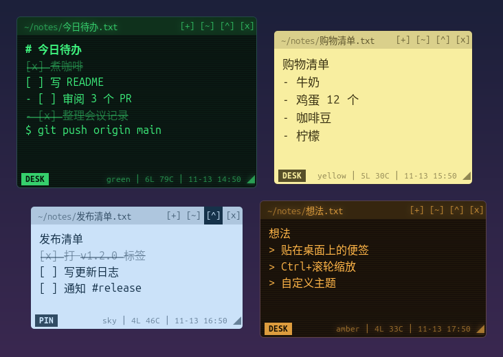

# sticky-notes

[English](README.md) | [한국어](README.ko.md) | **简体中文**

**贴在 Linux（GNOME、Wayland）桌面上的便签。** 便签在每个工作区都待在其他窗口下方的桌面上，要用时再浮到前面。默认是终端风格主题，也可以一键换成纸质便利贴主题或你自己做的主题。



## 特点

- **贴在桌面上**：便签位于其他窗口下方，并显示在所有工作区。点击便签，或在活动概览、Alt+Tab 中选中它，这张便签就会浮到最前面；点击别处又会回到桌面。
- **记住位置和大小**：重新启动或重新登录后，便签会回到原来的位置和大小。
- **主题**：6 个带 CRT 扫描线和辉光的终端主题、5 个纸质便利贴主题，以及[自己制作的主题文件](#制作自己的主题)。
- **终端风格**：等宽字体、像文件名一样的标题栏、vim 风格的状态栏。
- **待办清单**：点击 `[ ]` 变成 `[x]`，完成的行会加上删除线。
- **撤销 / 重做**：逐字撤销。粘贴和勾选框切换一次撤销。
- **每张便签单独调整字号**：8–32 pt。
- **删除确认**：有内容的便签会像 `rm -i` 一样先用 `[y/N]` 询问。
- **PEEK**：把所有便签暂时调到其他窗口上方查看。
- **中文（简体）、英文、韩文界面**：跟随系统语言。

## 系统要求

- Linux + GNOME Wayland 会话（通过 XWayland 运行）。已在 Ubuntu 26.04 / GNOME 50 上测试。
- Python 3、PyGObject、GTK 3

```sh
sudo apt install python3-gi gir1.2-gtk-3.0
```

字体使用 `Ubuntu Sans Mono`，中日韩文字使用与系统语言对应的 `Noto Sans Mono CJK`（`fonts-noto-cjk`），中文环境下为 SC 版本。两者都没有时使用系统等宽字体。

## 安装

```sh
git clone https://github.com/Kimsunmin/sticky-notes.git
cd sticky-notes
./install.sh              # 添加到应用网格
./install.sh --autostart  # 同时设置登录时自动启动
```

`install.sh` 会把桌面文件放到 `~/.local/share/applications`，把图标放到 `~/.local/share/icons`。桌面文件直接运行仓库里的 `sticky_notes.py`，所以安装后请不要移动仓库文件夹。如果移动了，重新运行 `./install.sh` 即可。

## 更新

```sh
cd sticky-notes
git pull
./install.sh
```

`install.sh` 会重新注册应用（如果开启了自动启动，也会一起更新），并用新代码重新启动正在运行的应用。便签单独保存，不会丢失。

## 使用方法

在应用网格中启动 **便签**，或运行 `./sticky_notes.py`。

### 鼠标

| 操作 | 方法 |
|---|---|
| 移动 | 拖动标题栏 |
| 调整大小 | 拖动右下角的 `◢` |
| 新建 / 主题 / 置顶 / 删除 | 标题栏上的 `[+]` `[~]` `[^]` `[x]` |
| 切换勾选框 | 点击 `[ ]` 或 `[x]` |

### 快捷键

| 按键 | 操作 |
|---|---|
| Ctrl+N | 新建便签 |
| Ctrl+T | 切换到下一个主题 |
| Ctrl+P | 固定在其他窗口上方 / 取消固定 |
| Ctrl+W | 删除便签（按 `y` 确认，其他键取消） |
| Ctrl+Z | 撤销 |
| Ctrl+Shift+Z、Ctrl+Y | 重做 |
| Ctrl+= / Ctrl+- / Ctrl+0 | 放大 / 缩小 / 默认（12 pt）字号 |
| Ctrl+鼠标滚轮 | 调整字号 |

### 状态栏模式

| 模式 | 含义 |
|---|---|
| `DESK` | 在桌面上，位于其他窗口下方（获得焦点时才在上方） |
| `PIN` | 固定在其他窗口上方 |
| `PEEK` | 暂时调到前面查看 |

### 查看被遮住的便签 (PEEK)

应用已在运行时再次启动它（例如在应用网格中点击图标），所有便签都会浮到其他窗口上方。点击便签以外的地方或再启动一次，便签就会回到桌面。

用 `--new` 参数启动会把便签调到前面并新建一张便签。也可以右键点击应用图标，选择 **新建便签**。把它设成 GNOME 快捷键会很方便：

> 设置 → 键盘 → 键盘快捷键 → 自定义快捷键
> 命令：`/仓库/路径/sticky_notes.py --new`

### 便签语法

```text
# 标题              粗体
[ ] 待办            点击变成 [x]
- [x] 已完成        删除线
* [ ] 这也是勾选框
```

标题栏中的 `~/notes/第一行.txt` 是根据第一行生成的显示名称，并不是真实的文件。

## 主题

| 类型 | 主题 |
|---|---|
| 终端（CRT 扫描线和辉光） | `green`（默认）、`amber`、`cyan`、`magenta`、`red`、`white` |
| 纸质 | `yellow`、`pink`、`sky`、`mint`、`lilac` |

点击 `[~]` 可以在带颜色样本的列表中选择主题，按 Ctrl+T 切换到下一个主题。每张便签的主题各自独立。

### 制作自己的主题

在 `~/.config/sticky-notes/themes/` 文件夹中放一个 `名称.theme` 文件，就会多出一个主题。`[~]` 菜单底部的 **打开主题文件夹** 可以打开这个文件夹。

```ini
# ~/.config/sticky-notes/themes/ocean.theme
[Theme]
Foreground=#e0f7ff
Background=#0b2a4a
Crt=true
```

| 键 | 含义 |
|---|---|
| `Foreground` | 文字颜色。可以使用任何 CSS 颜色：`#rrggbb`、`rgb(…)` 或 `navy` 这样的名称。 |
| `Background` | 背景颜色 |
| `Crt` | 为 `true` 时加上终端主题的扫描线和辉光，背景也会更透明一些。省略时为 `false`。 |

- 文件名（不含 `.theme`）就是主题名称，只能使用英文字母、数字、`-` 和 `_`。
- 与内置主题同名时会替换内置主题。
- 修改文件后重新打开 `[~]` 菜单即可生效。
- 无法读取的文件会被跳过，原因会输出到 stderr。使用该主题的便签在文件修好之前显示为 `green`，便签的主题设置不会丢失。

## 常见问题

### 在 GNOME Wayland 下怎样把便签固定在桌面上？

GNOME Wayland 不允许应用把自己的窗口放到其他窗口下方。sticky-notes 通过 XWayland 运行并使用标准的 X11 窗口提示，因此便签会留在每个工作区的桌面上、其他窗口的下方。安装并启动即可，无需任何设置。

### 为什么便签会出现在 Alt+Tab 和 Dock 栏中？

在 GNOME 中，同一个窗口提示会让窗口同时从 Dock 栏、Alt+Tab 和活动概览中隐藏。为了能在活动概览中找到便签，便签没有被隐藏，所以也会出现在 Alt+Tab 和 Dock 栏中。无论在哪里选中，那张便签都会浮到最前面。

### 便签被其他窗口挡住了，怎么查看？

在活动概览或 Alt+Tab 中选中它，或者再次启动应用把所有便签调到前面（[PEEK](#查看被遮住的便签-peek)）。想一直放在上方的便签可以按 Ctrl+P 固定。

### 便签保存在哪里？怎样备份？

所有便签都保存在 `~/.local/share/sticky-notes/notes.json` 这一个文件中。复制这个文件即可备份。

### 能在 KDE Plasma、Xfce 或 X11 会话中使用吗？

本项目只在 GNOME 50（Ubuntu 26.04，Wayland）上开发和测试。它使用标准的 EWMH 窗口提示，所以在其他桌面上也可能可用，但没有测试过。

## 数据

所有便签都保存在 `~/.local/share/sticky-notes/notes.json` 中，修改后 0.5 秒内保存。如果文件无法读取，不会覆盖它，而是改名为 `notes.broken-<时间>.json` 保留下来。

## 工作原理

在 GNOME Wayland 下，应用无法决定自己窗口的位置，也无法请求"始终在下方"之类的状态。因此 sticky-notes 用 X11 后端（XWayland）运行 GTK 3，并使用以下 X11 窗口提示：

- `_NET_WM_STATE_BELOW` / `ABOVE`：在桌面上 / 固定或获得焦点
- `_NET_WM_STATE_STICKY`：显示在所有工作区
- 从 Motif 提示中去掉最大化和最小化：拖到屏幕边缘时不会被平铺

没有使用 `_NET_WM_STATE_SKIP_TASKBAR`，因为 GNOME 会因此把便签从活动概览中也隐藏起来，而不只是 Dock 栏和 Alt+Tab。

如果使用 GTK 的客户端装饰（CSD），mutter 会按阴影宽度错位放置窗口，便签每次启动都会偏移一点。因此每张便签都是无装饰的 RGBA 窗口，自己绘制边框和圆角。

## 已知限制

- "显示桌面"（Super+D）会隐藏所有普通窗口，便签也可能一起被隐藏。
- 作为 XWayland 应用，在分数缩放（125% 等）下可能显得模糊。
- 便签没有窗口阴影，只能用 `◢` 手柄调整大小。
- 撤销记录只保存在内存中，重启应用后会消失。
- 删除最后一张便签会退出应用。再次启动应用会打开一张新便签。

## 卸载

```sh
./sticky_notes.py --quit   # 如果正在运行则退出
rm -f ~/.local/share/applications/com.kimsunmin.StickyNotes.desktop \
   ~/.local/share/icons/hicolor/scalable/apps/com.kimsunmin.StickyNotes.svg \
   ~/.config/autostart/com.kimsunmin.StickyNotes.desktop
rm -r ~/.local/share/sticky-notes          # 同时删除便签
rm -r ~/.config/sticky-notes               # 同时删除主题
```

## 项目结构

```text
sticky_notes.py   整个应用（单个文件）
install.sh        安装、更新、--autostart 自动启动
data/             桌面文件模板、图标
docs/             截图
```

## 许可证

[MIT](LICENSE)
